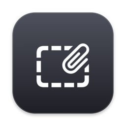
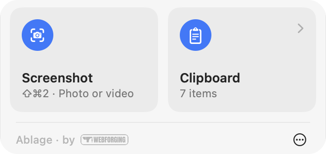
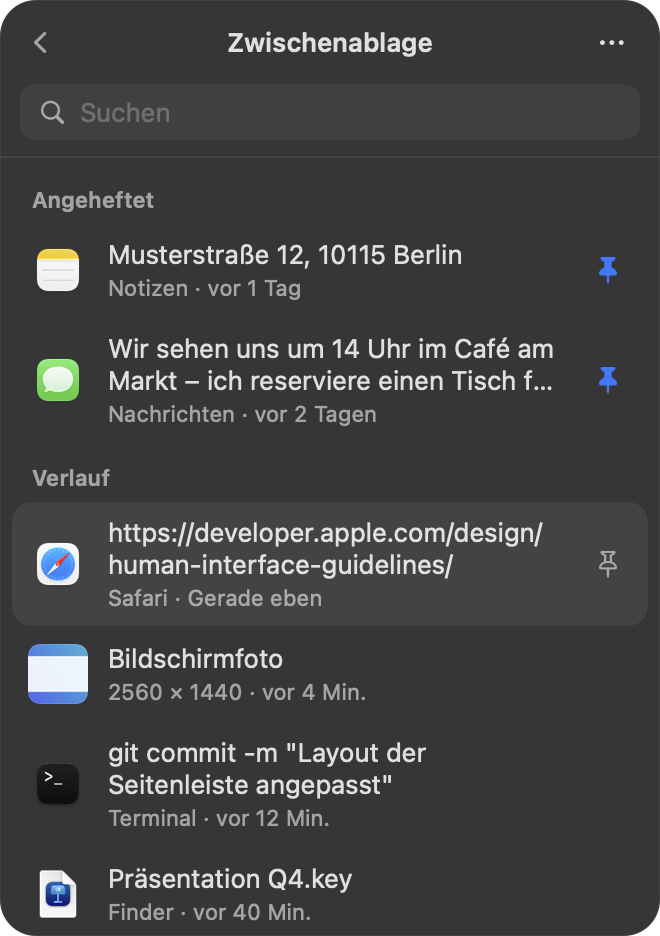
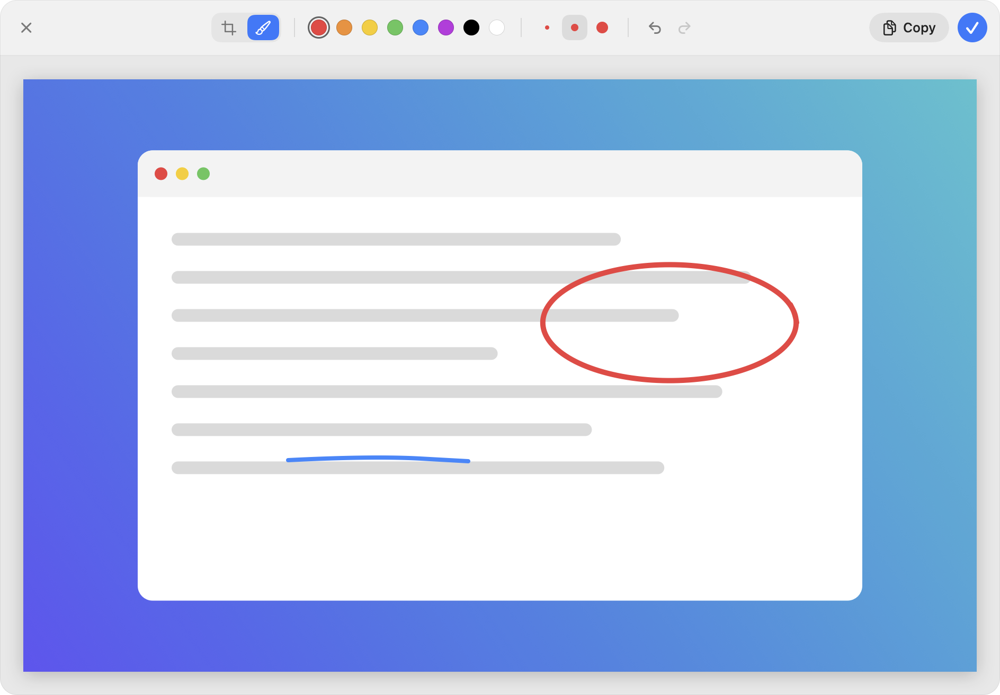
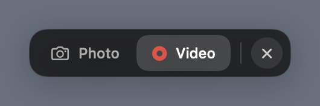
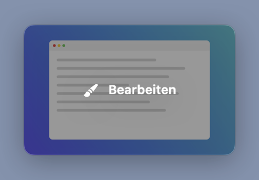

<p align="center">
  
</p>

<h1 align="center">Ablage</h1>

<p align="center">
  <strong>Screenshots, screen recordings and clipboard history – minimal, native, in your macOS menu bar.</strong><br>
  Free · Open source · Apple silicon &amp; Intel · macOS 15 Sequoia or later
</p>

<p align="center">
  <a href="https://github.com/TuttoBene1/Ablage-App/releases/latest/download/Ablage.dmg"></a>
</p>

<p align="center">
  
  
  
  
  
</p>

<p align="center">
  
  &nbsp;&nbsp;
  
</p>

<p align="center">
  <sub>Made by</sub><br>
  <a href="https://webforging.de/app-entwicklung"></a>
</p>

---

Ablage is a small, native utility for your Mac's menu bar. Click the icon in the top-right corner and you get
two tiles: **Screenshot** and **Clipboard**. No Dock icon, no windows in the way, no account, no cloud –
everything stays on your Mac.

## Features

**Screenshots & screen recordings**
- Press **⇧⌘2** anywhere (or click the menu bar icon): the screen dims, the cursor becomes a crosshair –
  drag a region and you're done. The shortcut can be changed or turned off in the panel.
- The screenshot is copied instantly (⌘V), at full Retina resolution.
- Switch to **Video** first to record the region as a screen recording (.mov, 60 fps).
  Stop it from the menu bar; the video is saved to Movies and copied to the clipboard.
- Works across multiple displays, and Ablage itself never shows up in a capture.

**Preview & editor**
- After every screenshot a small preview slides in at the bottom right.
- Click it to open the editor: **crop**, **brush** with 8 colors and 3 sizes, undo and redo.
- **Copy** puts the edited image on the clipboard; **✓** copies it and closes the editor.

**Clipboard history**
- Your last 25 copied texts, images and files – with source app and time.
- **Pin** items to keep them for good; pinned items are never pushed out.
- Click an item to copy it again. Includes search and full keyboard control.
- Content that password managers mark as concealed is never stored.

<p align="center">
  
</p>

<p align="center">
  
  &nbsp;
  
</p>

## Installation

### Option 1: Download the DMG

1. **[Download Ablage.dmg](https://github.com/TuttoBene1/Ablage-App/releases/latest/download/Ablage.dmg)**
2. Open the DMG and drag **Ablage** into **Applications**.
3. Open Ablage. On first launch macOS reports that the app can't be verified (Ablage is not notarized by Apple).
   Once, go to **System Settings › Privacy & Security** and click **Open Anyway** next to Ablage.

### Option 2: One command in Terminal

```bash
curl -fsSL https://raw.githubusercontent.com/TuttoBene1/Ablage-App/main/install.sh | bash
```

Downloads the latest release, installs it to `/Applications` and launches Ablage. Run it again to update.

### Screen recording permission

Screenshots need the macOS permission **Screen & System Audio Recording**. macOS asks for it on the first
screenshot; you can also enable “Ablage” under *System Settings › Privacy & Security › Screen & System Audio Recording*.

macOS additionally asks again from time to time for every app that captures the screen directly.
Choose **Allow** there – “Open System Settings” does not count as approval.

### Requirements

- macOS 15 Sequoia or later (including macOS 26 and 27)
- Apple silicon or Intel – Ablage ships as a universal binary

## Usage

| Action | How |
| --- | --- |
| Take a screenshot | `⇧⌘2` (change it under ⋯ › Keyboard Shortcut…) |
| Open the panel | Click the menu bar icon |
| Quick menu (Shortcut, Open at Login, About, Quit) | Right-click the menu bar icon |
| Select a region | Drag with the crosshair |
| Switch photo / video | Capture bar or `P` / `V` |
| Cancel the selection | `esc` or right-click |
| Stop a recording | Click the stop icon in the menu bar or press the shortcut again |
| Editor: crop / brush | `C` / `P` |
| Editor: undo / redo | `⌘Z` / `⇧⌘Z` |
| Editor: copy / done / close | `⌘C` / `↩` / `esc` |
| History: search | Just start typing |
| History: select / copy | `↑` `↓` / `↩` |
| History: pin / delete | `⌘P` / `⌘⌫` |

## Privacy

- Ablage makes **no network connections**, collects no data and contains no tracking.
- The history is stored locally in `~/Library/Application Support/Ablage`.
- Content that password managers mark as concealed is never stored.

## Uninstall

Quit Ablage (right-click the icon › Quit Ablage), then:

```bash
rm -rf /Applications/Ablage.app ~/Library/Application\ Support/Ablage
```

## Build from source

Requires the Xcode Command Line Tools (`xcode-select --install`).

```bash
git clone https://github.com/TuttoBene1/Ablage-App.git
cd Ablage-App
./build.sh --install    # build, install to /Applications and launch
./build.sh --release    # create dist/Ablage.dmg and dist/Ablage-macOS.zip
```

Local builds are signed with a self-signed certificate (`Scripts/signing.sh`) so macOS keeps the
screen recording permission across updates.

For development: `Ablage --snapshot <folder>` renders every screen with sample data as PNG,
and `Ablage --selftest` checks the panel, scrolling and the editor automatically.

Releases are built by GitHub Actions whenever a `v*` tag is pushed.

## License

[MIT](LICENSE) © 2026 Webforging

<p align="center">
  <br>
  <a href="https://webforging.de/app-entwicklung"></a><br>
  <sub><a href="https://webforging.de/app-entwicklung">App development by Webforging</a></sub>
</p>
